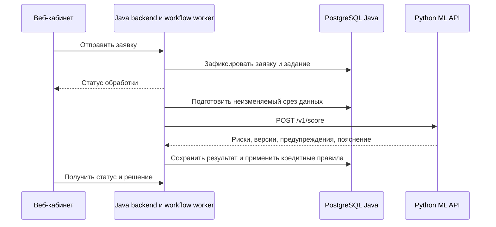

# Интеграция Java backend с ML-сервисом

Этот документ описывает подключение существующего Spring backend из `backend/`.
Сетевой ML-провайдер в Java **пока не подключён**: сейчас `SCORING_PROVIDER=rule-based`
выбирает `RuleBasedScoringProvider`, а `mock` — `MockScoringProvider`. Ни запуск
контейнера ML, ни переменная с его URL сами по себе не заменяют провайдер.

## Разделение ответственности

Рекомендуемая схема:



Java владеет пользователями, Keycloak, компаниями, заявками, продуктами, документами,
статусами, workflow, кредитными решениями и выдачей. Python собирает признаки,
выполняет ONNX и рассчитывает кассовый разрыв. ML не читает Java PostgreSQL,
не получает JPA-сущности, UUID заявки или токен пользователя.

В репозитории также есть самостоятельный [Python backend](BACKEND.md) с PostgreSQL
и очередью: это альтернативный демонстрационный контур. Его `/api/v1/*` требуют
`X-API-Key`; прямые ML-методы `/v1/*` этого заголовка не требуют. При использовании
Java workflow второй кредитный workflow Python не нужен. Схемы Java/Flyway и
Python/Alembic должны находиться в отдельных БД: таблицы имеют пересекающиеся имена.

## Запуск и адреса

Из корня репозитория, только ML:

```bash
docker compose -f compose.ml.yaml up --build -d --wait
curl --fail-with-body http://127.0.0.1:8001/health/ready
```

Java, запущенная на хосте, обращается к `http://127.0.0.1:8001`.
Чтобы поднять существующий Java-контур и ML в общей Docker-сети:

```bash
docker compose -p crednexus -f compose.yaml -f compose.ml.yaml up --build -d
```

Внутри этой сети адрес ML — `http://ml:8000`; `localhost` в контейнере Java указывает
на сам контейнер. Если ML уже запущен отдельным Compose-проектом, сначала остановите
тот проект командой `docker compose -f compose.ml.yaml down`, сохранив данные других
стеков. Java readiness и Swagger остаются частью Java-контра: `/actuator/health`
и `/swagger-ui/index.html` на порту 8080. ML Swagger — `http://127.0.0.1:8001/docs`.

`compose.yaml` сохраняет Java, PostgreSQL, Keycloak и MinIO из основной ветки.
`compose.python.yaml` запускает альтернативный Python backend, worker и отдельную БД
на портах 8000 и 5433; `compose.ml.yaml` — только вычислительный API на 8001.
Для текущих деревьев ONNX используется CPU даже при наличии CUDA; GPU не требуется.
Параметры устройства и проверки описаны в [CI.md](CI.md).

Прямой ML API рассчитан на внутреннюю сеть, собственной аутентификации в нём нет.
Опубликованный порт привязан к loopback. Доступ браузера идёт через Java backend.

## Методы и схемы

| Метод | Запрос | Ответ |
|---|---|---|
| `GET /health/live` | — | `{"status":"alive"}` |
| `GET /health/ready` | — | Готовность моделей, версии, runtime; 503 до готовности |
| `POST /v1/score` | `ScoreRequest` | Две вероятности неблагоприятного исхода на 12 месяцев |
| `POST /v1/forecast` | `ForecastRequest` | Прогноз операционных потоков на 1–3 месяца |
| `POST /v1/cash-gap` | `CashGapRequest` | Базовый и неблагоприятный сценарии остатков |

Машиночитаемый контракт: [openapi-ml.json](openapi-ml.json); актуальный контракт
запущенного сервиса — `GET /openapi.json`. Снимок генерируется из приложения,
без загрузки моделей и без БД:

```bash
cd ml-service
python scripts/export_openapi.py
python scripts/export_openapi.py --check
```

Снимок содержит схемы успешных ответов и реальный формат ошибки 422. Ошибки 500 и
503 перечислены ниже: клиент обязан обрабатывать их даже при генерации DTO из схемы.
Не путайте OpenAPI Java на `/v3/api-docs` с OpenAPI Python на `/openapi.json`.

## Как собрать запрос из Java

Полные валидные примеры: [score_request.json](../examples/score_request.json),
[forecast_request.json](../examples/forecast_request.json),
[cash_gap_request.json](../examples/cash_gap_request.json).
Их можно использовать для первого интеграционного теста, но не подставлять вместо
данных конкретной заявки.

| Данные ML | Источник / действие в текущей Java-модели |
|---|---|
| `application.requested_amount`, `term_months` | `LoanApplication.requestedAmount`, `termMonths` |
| `application.annual_rate`, `product_limit` | Зафиксированные условия `CreditProduct.baseRate`, `maxAmount`; проверить единицы ставки |
| `application.purpose` | Явное соответствие цели заявки категориям модели; не название продукта |
| `company.sector`, `business_age_months` | Добавить отрасль и возраст на месяц среза: в `Company` их сейчас нет |
| `financial_snapshot.legal_form` | Нормализовать `Company.legalForm` в `IP` / `OOO` |
| `financial_snapshot.debt_outstanding` | `FinancialSnapshot.existingDebt`, только если это долг на тот же месяц |
| `financial_snapshot.existing_monthly_debt_service` | `FinancialSnapshot.monthlyPayments`, только при совпадении смысла и даты |
| `history` | Добавить источник месячных наблюдений; `annualRevenue` и `annualExpenses` недостаточны |
| Прочие поля `financial_snapshot` | Добавить дебиторку, кредиторку, просрочки, запасы, концентрации и состояние бизнеса |
| `bureau_history` | Добавить 12 месячных DPD: `hasOverdue` / `creditHistory` из текущего БКИ-мока недостаточны |
| `cash_plan` | Графики платежей, инвестиций, нового финансирования и прочих денежных движений |

Годовую выручку нельзя делить на 12 и выдавать за наблюдённую помесячную историю.
`FinancialSnapshot.period` нельзя автоматически считать датой закрытого месяца.
Отсутствие долга/просрочек должно подтверждаться источником; неизвестное значение
не превращается в ноль. Для MVP источники могут быть синтетическими, с явной датой
среза и повторяемыми значениями.

Общие правила сериализации:

- JSON использует `snake_case`; настройте naming strategy только у DTO ML или
  задайте имена полей явно, сохраняя существующие Java API.
- Деньги — JSON-числа в рублях. В Java используйте `BigDecimal`, на выходе ML для
  вероятностей допустим `double`. Строки `"100000"` вместо числа отклоняются.
- `annual_rate=0.18` означает 18% годовых; допустимо 0–1. Возраст и сроки — целые месяцы.
- `as_of_month` и все месяцы — `LocalDate`, строго `YYYY-MM-01`. Это последний
  **закрытый** месяц; модель не определяет его по системным часам.
- `history` содержит 3–120 уникальных месяцев и все пять показателей в каждой
  записи: `sales`, `cash_inflow`, `operating_cash_outflow`, `cash_balance`,
  `operating_expense`. Поле с неизвестным наблюдением передаётся как `null`, а не
  удаляется глобальным `NON_NULL`. Нулевое наблюдение передаётся числом `0`.
- Последние три месяца обязательны. Для каждого показателя в них должно быть
  хотя бы одно известное значение. Лучше передать последние 13 месяцев: нужны
  сезонные признаки и сравнение с прошлым годом. Будущее и дубли отклоняются.
- Скоринг дополнительно требует `application`, полный `financial_snapshot` на
  `as_of_month` и ровно 12 последовательных `bureau_history`, включая месяц среза.
- Прогнозу нужны только общие поля и необязательные `horizons`, уникальные числа
  от 1 до 3. Скоринговые блоки в этот запрос не включать.
- Кассовому разрыву нужны `months` (1–3), `minimum_cash_reserve` и `cash_plan`
  на каждый будущий месяц. Поля плана `debt_service`, `investments`,
  `financing_inflow`, `other_inflow`, `other_outflow` обязательны, включая нули.
  Остаток `cash_balance` на месяц среза должен быть известен.
- Лишние поля запрещены: передавайте отдельный DTO, не сериализуйте JPA-сущность.

Детальные пределы и межполевые ограничения находятся в [API.md](API.md) и OpenAPI.

## Асинхронный Java-клиент

Готовый транспортный пример без сторонних зависимостей:
[CredNexusMlClient.java](../examples/java/com/crednexus/integration/ml/CredNexusMlClient.java).
Он использует JDK 25 `HttpClient.sendAsync`, один пул соединений, connect timeout
2 секунды, timeout запроса 10 секунд, UTF-8, без автоматических повторов. Результат —
`CompletableFuture<String>` с JSON. Сериализацию DTO и сохранение выполняет вызывающий
код; это пример клиента, а не уже зарегистрированный `ScoringProvider`.

Проверка из `ml-service` при запущенном ML и установленном JDK 25:

```bash
javac -d /tmp/crednexus-java examples/java/com/crednexus/integration/ml/CredNexusMlClient.java
java -cp /tmp/crednexus-java com.crednexus.integration.ml.CredNexusMlClient http://127.0.0.1:8001 ready
java -cp /tmp/crednexus-java com.crednexus.integration.ml.CredNexusMlClient http://127.0.0.1:8001 score examples/score_request.json
java -cp /tmp/crednexus-java com.crednexus.integration.ml.CredNexusMlClient http://127.0.0.1:8001 forecast examples/forecast_request.json
java -cp /tmp/crednexus-java com.crednexus.integration.ml.CredNexusMlClient http://127.0.0.1:8001 cash-gap examples/cash_gap_request.json
```

Для Spring скопируйте пример в `backend/src/main/java/com/crednexus/integration/ml/`
и зарегистрируйте singleton bean, закрываемый при остановке приложения:

```java
@Configuration
class MlConfiguration {
    @Bean(destroyMethod = "close")
    CredNexusMlClient mlClient(
            @Value("${crednexus.ml.base-url:http://127.0.0.1:8001}") String baseUrl) {
        return new CredNexusMlClient(URI.create(baseUrl));
    }
}
```

Импорты здесь: `java.net.URI`, `org.springframework.context.annotation.Bean`,
`org.springframework.context.annotation.Configuration`,
`org.springframework.beans.factory.annotation.Value` и класс клиента.
В Docker передайте `CREDNEXUS_ML_BASE_URL=http://ml:8000` **после добавления bean**.
`sendAsync` возвращает future; `join()` блокирует вызывающий поток и в случае ошибки
оборачивает причину в `CompletionException`. Проверяйте `getCause()`:
`MlHttpException.status()` содержит HTTP-код, `responseBody()` — тело для разбора
ошибки 422; сетевые ошибки приходят как причины future. Клиент не логирует запросы.
CLI печатает результат и предназначен только для синтетических примеров.

Для синхронного варианта Spring предлагает `RestClient`; для реактивного —
`WebClient`. Транспорт не делает JDBC/JPA асинхронными. Не переносите JPA-объекты
или контекст транзакции в callback future: подготовьте обычный неизменяемый DTO,
а запись результата вызовите отдельным Spring-сервисом с собственной транзакцией.

## Встраивание в текущий workflow

Точки изменения в Java:

1. `ScoringInput.FinancialData` сейчас содержит годовые итоги. Расширьте вход или
   добавьте `MlInputAssembler`, собирающий версионированный месячный профиль.
   Доступный `ScoringInput` сам по себе не позволяет построить полный ML-запрос.
2. Добавьте `HttpScoringProvider` с `@ConditionalOnProperty(name="scoring.provider",
   havingValue="ml")`. Значение `SCORING_PROVIDER=ml` **ещё не поддерживается**:
   до реализации такого bean оно приведёт к отсутствию `ScoringProvider` при старте.
3. `ScoringService.calculate()` и `ScoringJobProcessor.process()` сейчас выполняются
   в `@Transactional` и держат блокировки. Перед HTTP-вызовом разделите обработку:
   короткая транзакция готовит срез и идентификатор попытки; запрос идёт вне
   транзакции; отдельная транзакция проверяет актуальность попытки и сохраняет ответ.
   Снять аннотацию только с одного метода недостаточно из-за внешней транзакции.
4. При завершении сравнивайте статус заявки, revision среза и token попытки/lease.
   Просроченный worker не должен переписывать результат новой попытки. После
   успешного сохранения завершайте задание и ставьте решение в очередь атомарно.
5. Адаптируйте `ScoringOutput` и потребителей результата: существующий Java score
   0–100 с направлением «больше — лучше» не равен ML-вероятности 0–1 с направлением
   «больше — рискованнее». Сохраняйте исходные вероятности отдельно. Если UI нужен
   score, формулу и риск-пороги вводите отдельной версией Java policy. Не применяйте
   пороги текущего `RuleBasedScoringProvider` к вероятности и не объявляйте его
   балльную шкалу откалиброванной PD.
6. Добавьте отдельные Java операции прогноза и кассового разрыва. Они могут
   использовать тот же транспорт и месячный профиль без полного кредитного контекста.

`WorkflowJobRecoveryService` сейчас повторяет любые ошибки до лимита попыток.
Для HTTP-интеграции нужно разделить постоянные ошибки контракта и временные отказы
сервиса; не повторять 422 с тем же payload. Принятие изменённых условий требует
нового скоринга с фактическими суммой, сроком и ставкой.

## Как читать и хранить ответ

Общие поля: `model_version` (идентификатор комплекта `onnx-sha256:...`),
`feature_version` (`monthly-v1`), `warnings` и необязательное `explanation`.
Не подменяйте версию модели версией API или временем вызова. Сохраняйте raw JSON,
версию политики Java, hash/идентификатор среза, время, тип операции и статус попытки.
Настройте DTO ответов на игнорирование новых полей; обязательные вероятности,
версии и структуру результата всё равно проверяйте, не допускайте default `0`
из отсутствующего поля.

| Результат | Значение для Java |
|---|---|
| `default_next12m` | Вероятность сценарного неблагоприятного кредитного события; не балл и не готовое решение |
| `default_90dpd_next12m` | Отдельная вероятность события 90+ DPD |
| `forecasts[].cash_inflow`, `operating_cash_outflow` | `lower`, `prediction`, `upper`, суммы в рублях |
| `operating_net_cash_flow` | Разность прогнозных операционных потоков; это не остаток |
| `interval_nominal_coverage` | Номинальная цель калибровки 0.9; не гарантия покрытия на новых данных |
| `base`, `adverse` | Два сценария кассового разрыва; adverse не является вероятностью разрыва |
| `first_cash_gap_month` | Первый будущий месяц с остатком < 0; `null` — разрыва на горизонте нет |
| `funding_to_avoid_cash_gap` | Максимальная накопленная потребность в финансировании, не сумма месячных дефицитов |
| `funding_to_maintain_reserve` | Потребность для сохранения заданного резерва, включая начальный остаток |
| `explanation` | Русский шаблон: `title`, `summary`, `facts`, `next_steps`, `limitations`, версия шаблона |

Всегда сохраняйте и показывайте значимые предупреждения качества: `SYNTHETIC_MODEL`,
`INCOMPLETE_HISTORY`, `SHORT_HISTORY`, `UNKNOWN_CATEGORY`, `RATE_FLOOR`.
Неизвестный будущий код предупреждения не должен ломать десериализацию enum.
Шаблоны объясняют рассчитанные показатели, не содержат SHAP или причинного
объяснения модели и не заменяют кредитные причины отказа из Java policy.

## Ошибки, повторы и согласованность

| Ситуация | Действие Java |
|---|---|
| 200 | Проверить ответ, сохранить с версиями и применить policy |
| 422 `VALIDATION_ERROR` | Разобрать `errors[].location/type/message`; исправить данные или запросить сведения; не повторять тот же запрос |
| 500 `INFERENCE_ERROR` | Ограниченный повтор с задержкой; затем технический статус / ручное рассмотрение |
| 503 | Временная неготовность; проверить readiness, повторить с задержкой |
| Timeout / connection refused | Считать попытку технически неуспешной, а не кредитным отказом |
| 401/403/404 | Проверить адрес, gateway и конфигурацию; автоматический бесконечный повтор не нужен |

Пример фактической ошибки:

```json
{
  "code": "VALIDATION_ERROR",
  "errors": [{
    "location": ["body", "history", 0, "sales"],
    "type": "greater_than_equal",
    "message": "Input should be greater than or equal to 0"
  }]
}
```

В 503 тело имеет вид `{"detail":"Models are not ready"}`; ошибки прокси могут иметь
другой формат. Не пытайтесь разбирать любой неуспешный ответ как `ScoreResponse`.
Рекомендуемое стартовое ограничение — 3 попытки, задержки около 1 и 3 секунд с jitter;
согласуйте timeout и суммарное время с lease Java-задания. Ограничьте число
одновременных вызовов, не создавайте отдельный ONNX-процесс на каждый запрос.

Прямые ML-методы не сохраняют результат и не реализуют `Idempotency-Key`.
Повтор вычисления не создаёт заявку/решение в Python. Дедупликация результата и
актуальность среза остаются в Java; одинаковые наблюдения после смены модели могут
дать другой ответ. При необходимости переиспользования результата ключ должен
включать тип операции, hash входа и версии модели/признаков/расчёта.
Логи — только технические ID, код ошибки и длительность, без полного финансового
payload, токенов и ключей.

## Приёмка интеграции

До переключения провайдера проверьте: три успешных запроса на fixtures; 422 для
дублей/некорректного месяца/строки вместо суммы; корректные `null`; сохранение версий
и предупреждений; различие PD и score; остановку ML и ограниченные повторы;
отсутствие открытой транзакции во время HTTP; отклонение запоздалой попытки;
повтор после рестарта worker без второго кредитного решения. Проверку HTTP-контракта
проводите против настоящего ML-контейнера, сценарии отказа — с подменяемым HTTP stub.

Источники по клиентам: [JDK 25 HttpClient](https://docs.oracle.com/en/java/javase/25/docs/api/java.net.http/java/net/http/HttpClient.html),
[Spring REST Clients](https://docs.spring.io/spring-framework/reference/integration/rest-clients.html).
